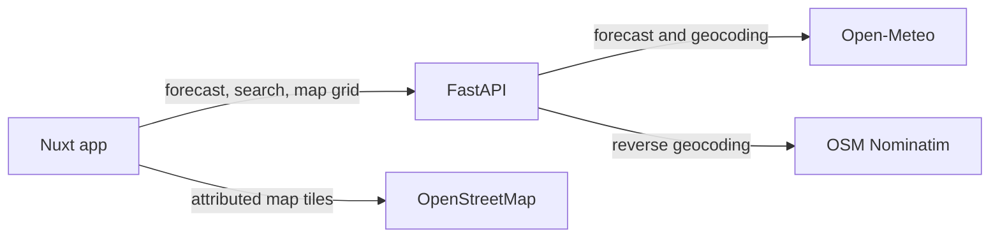

# WeatherCast

**Weather, in context.** WeatherCast turns a forecast into a clearer outdoor plan: see the conditions, understand why an activity is recommended, and explore how weather changes across a nearby area.

> WeatherCast is an independent portfolio project. Its recommendations are general planning guidance, not official alerts or professional weather, medical, or aviation advice.

## What makes it different

- **Advice with reasons:** walk, run, and cycling guidance explains which rain, wind, or feels-like conditions affected the recommendation and when they are expected.
- **A forecast you can explore:** current conditions, an interactive hourly chart, and a selectable seven-day outlook.
- **Nearby weather layers:** compare temperature, rain probability, and wind at nine points across the visible map. Select a point to open its complete forecast.
- **Low-friction location search:** city suggestions appear as you type; browser location is optional and the default city remains useful if permission is declined.
- **Comfortable in either language or theme:** English and Spanish, with system, light, and dark appearance preferences.

The advice uses documented, deterministic rules. There is no AI label or hidden recommendation model.

## Screenshots

Screenshots will be added after the first public release.

## Technology

| Area | Tools |
| --- | --- |
| API and weather rules | Python 3.12, FastAPI, Pydantic, HTTPX |
| Web app | Vue 3, Nuxt 3, TypeScript, Tailwind CSS |
| Charts and map | Custom accessible SVG chart, Leaflet, OpenStreetMap |
| Weather and geocoding | Open-Meteo, OpenStreetMap Nominatim |
| Typography | Self-hosted DM Sans Variable and Manrope Variable |
| Delivery | Docker Compose, GitHub Actions, Coolify |

The application is a modular monolith: HTTP routes validate requests, provider adapters normalize external responses, domain rules produce recommendations, and the Nuxt app presents the result. The map requests a fixed nine-point weather grid after map movement settles; one multi-coordinate forecast request supplies the points, and older browser requests are cancelled.



## Run locally

Requirements: Python 3.12+, Node.js 20+, and npm.

Start the API:

```sh
cd backend
python -m venv .venv
source .venv/bin/activate
pip install -e '.[dev]'
uvicorn app.main:app --reload
```

In a second terminal, start the web app:

```sh
cd frontend
npm ci
npm run dev
```

Open `http://localhost:3000`. The API health check is `http://localhost:8000/health`, and interactive API docs are at `http://localhost:8000/docs`. Set `NUXT_PUBLIC_API_BASE` if the API runs at another address.

## Run with Docker Compose

```sh
cp .env.example .env
docker compose -f compose.yaml -f compose.local.yaml up --build
```

Open `http://localhost:3000`; API docs are at `http://localhost:8000/docs`. Change `WEB_PORT`, `API_PORT`, `NUXT_PUBLIC_API_BASE`, and `CORS_ORIGINS` in `.env` when those ports or origins are already in use.

For Coolify and the Hetzner CAX21, follow the [deployment guide](docs/deployment-coolify.md). The production deployment is intentionally deferred until this branch is reviewed and merged into `main`.

## Quality checks

```sh
cd backend
python -m pip install -e '.[dev]'
ruff check app tests
ruff format --check app tests
pytest --cov=app --cov-report=term-missing --cov-fail-under=80

cd ../frontend
npm ci
npm run typecheck
npm test
npm run build
```

GitHub Actions runs the API lint, format, coverage, and test checks plus the frontend type check, unit tests, and production build on pushes to `main` and pull requests targeting `main`.

## Data, location, and attribution

- Weather forecasts and city suggestions come from [Open-Meteo](https://open-meteo.com/). The map layer uses one multi-coordinate forecast request per settled map view.
- Map dots are weather-model grid samples, not station observations or radar imagery.
- Nearby place names are resolved with [OpenStreetMap Nominatim](https://nominatim.org/). Map tiles use the standard [OpenStreetMap tile service](https://operations.osmfoundation.org/policies/tiles/), with visible attribution. These public services suit a small demo; review their usage rules and choose a service plan before scaling traffic.
- On page load, the app asks the browser for location so it can show nearby weather without an extra search; visitors can deny the request, and **Use my location** retries it. Coordinates are sent to Open-Meteo for the forecast and to Nominatim for the nearby place name. WeatherCast does not store them.
- Open-Meteo's free API is limited to non-commercial use. Review its current terms before commercial use.
- DM Sans and Manrope are bundled with the web app under the SIL Open Font License 1.1. License texts are in [`frontend/public/fonts`](frontend/public/fonts/).

## Repository guide

```text
backend/      FastAPI routes, provider adapters, weather rules, and tests
frontend/     Nuxt pages, map and chart components, and frontend tests
docs/         deployment, decisions, roadmap, and portfolio notes
```

Keep `main` releasable. Use short-lived branches such as `feat/weather-map-layers` and Conventional Commit messages such as `feat(api): add batched weather map points`. Keep provider-specific parsing in adapters, explain architectural changes in `docs/decisions/`, and include verification notes with each contribution. See [CONTRIBUTING.md](CONTRIBUTING.md), the [roadmap](docs/ROADMAP.md), and [portfolio project ideas](docs/PORTFOLIO.md).

Before a release, follow the [manual QA checklist](docs/qa-checklist.md) for search, browser location, map behavior, accessibility, responsive layouts, and container smoke checks.

## Portfolio direction

WeatherCast is the first of a small set of complete projects. Future ideas include a reproducible city-data story, a public API explorer, inventory and low-stock workflows, a vehicle comparison marketplace, a game companion, and a developer tool with both CLI and web interfaces. Each should solve a focused problem and show a different engineering skill.
